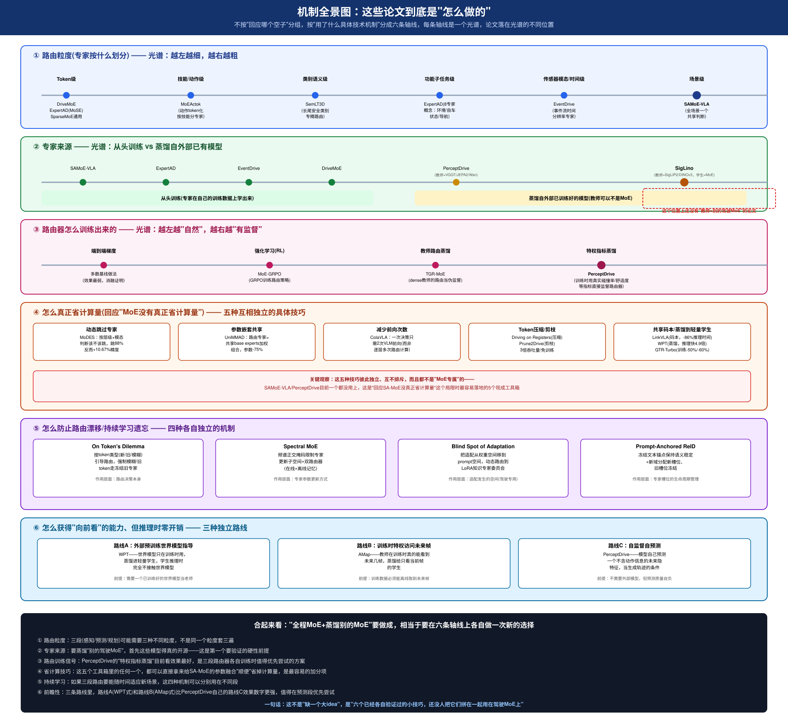

# 全程MoE 与 蒸馏：现状深度梳理(2026-10-22)

> 承接[机制全景图](notes/img/mechanism-taxonomy.svg)——那张图按"用了什么具体技术机制"把96篇论文拆成六条轴线。这篇文档专门把朱子欣idea的两个关键词单独拎出来，各自整理现状：**全程MoE到底有谁做到了几成**，**蒸馏在这个领域里到底有几种完全不同的用法**。

---

## 一、全程MoE现状：没有一篇做到三段独立路由，上限是两段

### 按"MoE路由覆盖了几段"排名

| 论文 | 感知段有MoE? | 预测段有MoE? | 规划段有MoE? | 实际覆盖 |
|---|---|---|---|---|
| [DriveMoE](notes/drivemoe.md) | ✅ Vision MoE(按摄像头视角选) | ❌ | ✅ Action MoE(按驾驶行为选) | **2/3段**，目前查到覆盖最多的 |
| [SAMoE-VLA](notes/samoe-vla.md) | ❌ | ❌ | ✅ SA-MoE(场景级参数融合) | 1/3段(规划) |
| [ExpertAD](notes/expertad.md) | ❌(PA是特征重加权，⚠不是MoE) | ✅ MoSE(8专家Top-4路由) | ❌(复用基线解码器) | 1/3段(预测)，**⚠abstract写"spans perception and planning"是误导性表述** |
| [EventDrive](notes/eventdrive.md) | ✅(事件编码阶段，按时间分辨率选) | ❌ | ❌ | 1/4段(感知编码)，但**评测覆盖感知-理解-预测-规划四维** |
| [PerceptDrive](notes/perceptdrive.md) | (先验来自冻结感知模型，非MoE) | ❌ | ✅ Expert Router(场景条件路由，融合感知先验) | 路由只发生**一次**(在规划阶段)，不是三段各自路由 |
| [DrivePI](notes/drivepi.md) | ✅ | ✅ | ✅ | **4段全覆盖，但完全没有MoE**——单一0.5B dense模型 |
| [Drive-KD](notes/drive-kd.md) | ✅ | ✅ | ✅ | **3段全覆盖(蒸馏意义上)，但蒸馏成一个dense学生，没有路由结构** |

### 核心结论

1. **"几段有MoE"和"几段被覆盖"是两件完全不同的事**，很多论文(尤其是摘要措辞)容易把两者混为一谈——ExpertAD就是一个活生生的反例，精读之前差点被abstract误导。

2. **目前查到的MoE段数上限是2段(DriveMoE)**，而且这2段还是SAMoE-VLA点名批评"token级+预定义标签、引入安全隐患"的那个设计。没有一篇做到3段独立路由。

3. **"全程覆盖"这件事本身不需要MoE**——DrivePI用0.5B的单一dense模型就做到了4段全覆盖，还打赢7B的VLA模型。这是一个很重要的反例：如果presentation/proposal里把"全程MoE"当成目标本身，DrivePI可以被用来质疑"为什么非要是MoE，不用MoE不行吗"——这个问题现在已经有人给出了"不用MoE也行"的实证答案，所以"全程MoE"的说服力必须建立在"MoE在每一段具体解决了什么dense模型解决不了的问题"上，而不是"三段都有MoE"这个数字本身。

4. **如果真要往"三段独立路由"这个方向做，三段的路由粒度大概率不该是同一种**(呼应机制图①)：
   - 感知段：可以借鉴EventDrive(按传感器模态/时间粒度)或SemLT3D(按类别语义，长尾安全类别)
   - 预测段：可以借鉴ExpertAD的MoSE设计思路(按功能子任务：环境/自车状态/导航)，这恰好是ExpertAD唯一做对的那一段
   - 规划段：可以借鉴SAMoE-VLA(按场景)或MoEActok(按技能)

---

## 二、蒸馏现状：同一个词底下至少藏着五种完全不同的东西

### 分类总览

| 蒸馏类型 | 核心目的 | 代表论文 | 教师是谁 | 学生保留路由结构吗 |
|---|---|---|---|---|
| **A. 压缩型**(大→小部署) | 推理效率 | [WPT](notes/wpt-world-policy.md)、[AMap](notes/amap.md) | 世界模型/特权未来帧教师 | ❌不保留，学生是单一轻量模型 |
| **B. 多专家合并型**(多个专才→一个通才) | 整合互补知识 | [SigLino](notes/siglino.md) | 多个独立预训练模型(SigLIP2+DINOv3) | ✅可以保留，学生可以是MoE |
| **C. 自我蒸馏型**(自己的历史当教师) | 免费获得更强模型，零外部依赖 | [GTR-Turbo](notes/gtr-turbo.md) | 自己训练过程中产生的历史checkpoint(合并后) | 不涉及MoE路由，是RL训练技巧 |
| **D. 防遗忘型**(蒸馏来稳定旧知识) | 持续学习不遗忘 | [Prompt-Anchored ReID](notes/prompt-anchored-reid.md)、[GKD](notes/gkd-semantic-seg.md) | 冻结的文本锚点/领域无关表征阶段 | 部分保留(新增槽位型) |
| **E. 特权信息型**(教师看得到学生看不到的东西) | 零推理开销获得能力 | [AMap](notes/amap.md)(未来帧)、[WPT](notes/wpt-world-policy.md)(世界模型预测) | 有特权access的离线教师 | ❌不保留 |

**朱子欣的idea"蒸馏别的MoE放到我们的MoE上"，精确地落在B类的子集里：不仅要多专家合并(B)，教师还必须本身就是MoE(而且是驾驶专用MoE)。** 目前B类只有SigLino做到了"教师可以不是MoE、学生是MoE"，但没有一篇做到"教师本身就是(驾驶)MoE"。

### 具体蒸馏损失/机制的技术目录(如果真要动手实现，这些是可以直接抄的现成工具)

| 机制 | 来源论文 | 解决的具体问题 |
|---|---|---|
| **ARKD(非对称关系蒸馏)** | SigLino | 多教师蒸馏时保留教师间的相对几何关系，而不是只对齐绝对位置 |
| **Retention Anchor(保留锚点)** | PerceptDrive | 用余弦相似度约束，防止压缩特征在只看最终任务损失时悄悄丢失专家先验 |
| **Privileged Metric Distillation(特权指标蒸馏)** | PerceptDrive | 训练时用真实碰撞率/舒适度等指标直接监督路由器，而非纯端到端梯度 |
| **TIES Merging** | GTR-Turbo | 合并多个checkpoint时用"修剪+符号投票+选择性平均"避免参数互相干扰 |
| **Reverse KL + Clip** | GTR-Turbo | 解决VLM输出空间巨大时KL散度蒸馏信号不稳定(可能为负)的问题 |
| **非对称查询蒸馏(匈牙利匹配+KL)** | AMap | 解决教师(查询多、带跟踪)和学生(查询少、单帧)之间查询数量不对等的蒸馏难题 |
| **分层token级蒸馏引导(TAG)** | On Token's Dilemma | 按token类型(新/旧/模糊)决定该不该参与蒸馏/路由，不是一刀切 |

### 核心结论

1. **"蒸馏别的MoE"这半句话，技术上最缺的不是"怎么蒸馏"(上面这张表已经有7种现成机制可以直接复用)，而是"去哪找一个真正开源的驾驶专用MoE当教师"**——这是一个数据/资源获取问题，不是算法设计问题。在投入设计这半部分之前，这个前提必须先验证。

2. **如果驾驶MoE教师确实找不到，退而求其次的方案**：用SigLino的配方，把"教师"换成**驾驶领域里已经开源的、各有所长的非MoE模型**(比如VGGT管几何、某个开源的驾驶VLM管语言推理)，走PerceptDrive已经验证过的路子——这样至少守住"蒸馏+冻结+轻量路由"这半个机制，只是"教师是MoE"这个条件暂时达不到，需要在故事里坦诚说明这个差异。

3. **GTR-Turbo的"自我蒸馏"(C类)是一个常被忽略但成本最低的选项**——如果SAMoE-VLA这类模型本身的训练过程会产生多个checkpoint，合并这些checkpoint当免费教师、反过来蒸馏指导路由器的训练，是不需要任何外部模型、不需要额外数据的"白捡"收益，值得作为baseline或者补充实验先试一下。

---

## 三、两件事合在一起看

把第一部分(全程MoE)和第二部分(蒸馏)的结论叠在一起，朱子欣的idea要真正成立，需要同时回答：

1. **三段路由粒度分别怎么选**(目前有现成模板可抄：感知借EventDrive/SemLT3D，预测借ExpertAD的MoSE，规划借SAMoE-VLA/MoEActok)；
2. **教师到底是谁**(理想情况是别的驾驶MoE，但先得确认开不开源；退路是用SigLino配方+非MoE驾驶专家)；
3. **路由器怎么训练**(PerceptDrive的特权指标蒸馏目前看效果最好，三段都可以各自配一个这样的监督信号)；
4. **顺便把计算量账算清楚**(机制图④那五个工具箱，SA-MoE和PerceptDrive目前一个都没用，是最容易拿到手的加分项)。

这四件事都不是"从零发明"，都有至少一篇论文给出过独立验证——缺的是把它们系统性地拼到一起、并且明确用在"驾驶MoE教师"这个还没人占的位置上。
