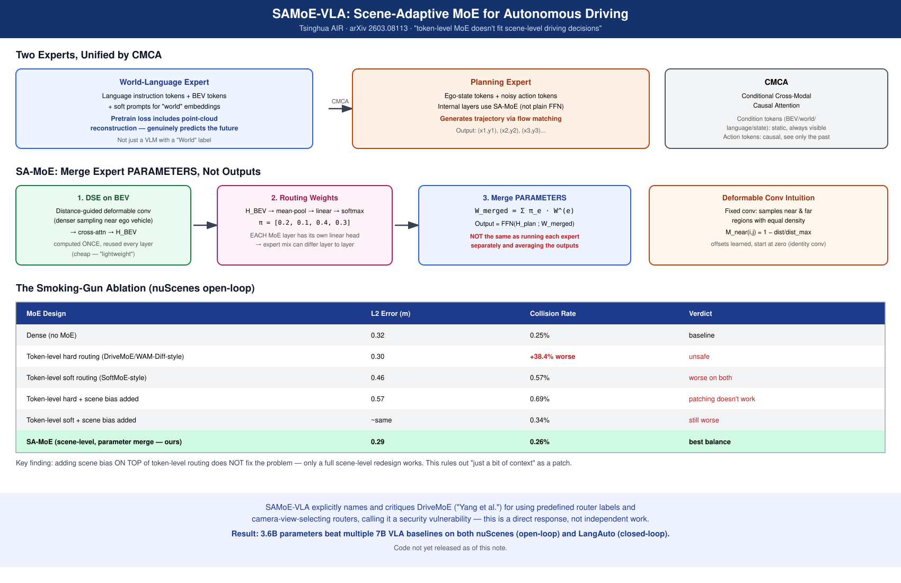

# SAMoE-VLA: A Scene Adaptive Mixture-of-Experts Vision-Language-Action Model for Autonomous Driving

- **Venue / year:** arXiv 2603.08113v1, 2026-03-09
- **Authors:** Zihan You, Hongwei Liu, Chenxu Dang, Zhe Wang, Sining Ang, Aoqi Wang, Yan Wang(通讯作者) — 清华大学 AIR(人工智能产业研究院)主导，合作单位包括东南大学、华中科技大学、中国科学技术大学、北京科技大学
- **Link:** https://arxiv.org/abs/2603.08113 ([本地PDF副本](pdf/samoe-vla.pdf))
- **来源说明:** 用户先贴了摘要，后续又贴了全文(Introduction/Related Work/Method/Experiments/Conclusion/大部分参考文献)，并贴了自己和Gemini就架构图、SA-MoE融合图、pretrain/final stage区别做的问答。本笔记以用户贴的论文原文为准，Gemini的图解读里有一处需要修正(见下方"⚠ 一处需要修正的说法")。
- **Code:** 论文写"Our code will be released soon"，截至本笔记整理时**未开源**
- **Input / 输入:** 人类指令(语言)+多视角摄像头图像(编码成BEV特征)+自车状态(ego-state)token+带噪声的动作token
- **Output / 输出:** 未来轨迹路点序列(通过flow matching生成)；预训练阶段额外输出场景描述文本+重建的未来点云

---

## TL;DR

**问题 →** VLA模型在自动驾驶上效果不错，但大家直接把LLM那套token级别的MoE路由机制(比如Mixtral那种)搬过来用，没人系统验证过这样做在驾驶场景里到底行不行。

**Gap →** 作者实测发现：token级MoE路由在驾驶任务上会导致碰撞率飙升(+38.4%)，根源是"按单个token分专家"和"按整个场景做决策"这两件事颗粒度对不上——但这一点此前没人系统验证、也没人提出对应的修正方案。

**Novelty →** 提出SAMoE-VLA：①把MoE的路由信号从"看单个token"换成"看BEV场景特征"(场景级，不是token级)；②路由方式不是选专家，是**把多个专家的FFN参数按场景算出的权重直接加权融合成一个新FFN**，再用这一个融合后的FFN计算；③配一个Conditional Cross-Modal Causal Attention(CMCA)机制统一世界/语言/动作信息的时序因果关系。

**核心洞察 →** MoE路由的"颗粒度"必须和任务的决策颗粒度匹配——语言建模里"按token分工"没问题，是因为语言本身就是逐token生成的；但驾驶决策是整个场景级别的全局判断，用token级路由会把一个连贯的场景决策拆得支离破碎，这是不稳定和碰撞率升高的根源。

**方法/论证 →** 两个专家(World-Language Expert处理语言+BEV+世界嵌入；Planning Expert用SA-MoE层处理自车状态+带噪动作token)，用CMCA统一；SA-MoE的路由信号来自一个叫DSE(Deformable Scene Encoder)的轻量模块，对BEV特征做"离自车越近采样越密"的可变形卷积，压缩成一个场景向量，这个向量只算一次、所有MoE层复用，但每层各自算专家权重；专家的FFN参数按权重加权求和融合成一个FFN，而不是分别跑每个专家再加权输出。

**结果 →** nuScenes开环平均L2 0.29m、碰撞率0.26%(都是最好)，LangAuto闭环三档评测Driving Score全部第一，而且只用3.6B参数，打赢了一堆7B的VLA基线(LMDrive/BEVDriver/OpenEMMA/ORION)。

**意义 →** 这篇论文做的不是"又一个驾驶MoE"，是**系统性地检验了"token级MoE搬到驾驶上到底行不行"这个此前没人认真测过的问题**，而且在Related Work里点名批评了DriveMoE(论文里称"Yang et al.[49]")用预定义router标签、限定摄像头视角选择的做法"引入了安全隐患"，是对同期MoE+驾驶工作的直接回应和修正。

---

## 贡献列表(按重要性排序)

**① 系统性验证token级MoE在驾驶场景的失效模式**(核心贡献，方法论价值最大)
不是空口说token级MoE不好，是做了5种基线的系统对比(dense/token级硬路由/token级软路由/token级硬路由+场景偏置/token级软路由+场景偏置)，发现**单纯给token级路由加一点场景信息是不够的，必须整个换成场景级才行**——token级硬路由碰撞率比dense基线高38.4%，这是全文最重要的实证证据。

**② Scene-Adaptive MoE(SA-MoE)：参数空间融合，不是输出空间融合**
路由信号来自BEV→DSE→场景向量，专家不是"选中就用、没选中就不用"，是把所有专家的FFN**参数**按权重线性组合成一个新FFN(`W_merged = Σ π_e · W^(e)`)，再用这一个融合后的FFN算一次。作者强调这和"分别跑完每个专家再加权求和输出"不等价(有非线性激活的情况下)。

**③ Deformable Scene Encoder(DSE)：按远近动态调整采样密度**
用一张基于自车距离的权重图`M_near`引导可变形卷积的采样偏移，让离自车近的区域采样更密集，解决普通固定卷积"近处和远处一视同仁"导致关键信息被稀释的问题。消融显示去掉DCN或去掉`M_near`都会让L2变差(各自约6.8%)。

**④ Conditional Cross-Modal Causal Attention(CMCA)**
把BEV/世界/语言/自车状态token当成"固定背景条件"(不参与更新、全程可见)，只有动作token之间保持因果顺序(后面的能看前面的，不能反过来)，用一个结构化的attention mask实现，配合flow matching需要的时序一致性。

**⑤ World-Language Expert做真正的世界建模，不只是"VLM"**
底座用"预训练的大型world vision-language model"而不是普通VLM，预训练阶段的损失函数包含"point cloud reconstruction loss"(预测未来点云)，消融显示去掉这个世界建模预训练步骤，L2从0.29变差到0.33——证明这个设计不是摆设。

---

## ⚠ 一处需要修正的说法

用户之前让Gemini解读架构图时，Gemini说"World-Language Expert里的World不代表它一定是预测未来环境的世界模型；仅凭这张图，还不能作出这个判断"。**这个保留态度是过度谨慎的**——结合论文正文(3.1节、3.4节)，这个"World"明确就是指预测未来状态的能力：原文写"The adoption of a World Vision-Language Model, in lieu of a common VLM, offers advantages by conferring the ability to predict future states and mitigating information losses typically associated with projection layer"，预训练阶段的损失函数也明确包含"point cloud reconstruction loss for world prediction"。Gemini当时只看了图没看全文，所以才留了这个口子；现在有全文可以确认，presentation时可以直接说这就是一个做未来状态预测的世界模型分支。

---

## Novelty 分类判断

- **新问题定义**：算——"token级MoE在自动驾驶场景下是否适用"这个问题此前没人系统验证过，这篇论文把它明确提出来并给出了实证检验(5种基线对比)。
- **新insight**：算——"MoE路由颗粒度要和决策颗粒度匹配"这个论证有具体数据支撑(token级硬路由碰撞率+38.4%，单纯加场景偏置不能解决问题)。
- **新方法**：算——SA-MoE的"参数空间加权融合"(而非选择或输出融合)这个具体机制，加上DSE的距离感知可变形卷积，都是具体的工程创新，此前没见过完全一样的设计。
- **新理论**：没有，MoE、可变形卷积、因果注意力都是已有技术，这里是组合应用+验证。
- **新数据集**：没有，用的是nuScenes和CARLA/LangAuto这些已有基准。
- **新应用场景**：不算，是方法论文。

综合结论：**新insight+新方法组合类贡献**，核心价值不在于"又造了一个MoE驾驶模型"，而在于系统性检验了一个此前被想当然搬用的设计选择(token级MoE)在新领域是否成立，并给出了有实证支撑的修正方案。

---

## 中文精读

### 1. 解决了什么问题

VLA模型在自动驾驶上越来越流行，大家也开始借鉴LLM领域已经验证好用的MoE(混合专家)架构来提升容量、降低参数量。但现有做法基本是直接照搬LLM的token级路由(比如Mixtral那种，看每个token该交给哪个专家)。SAMoE-VLA要回答的问题是：**这种token级的路由方式，在自动驾驶这个决策高度依赖全局场景理解、而不是逐词生成的任务上，是不是真的合适？**

### 2. 新意在哪里

**核心新意：把MoE路由的"颗粒度"从token级换成场景级，而且验证了这个颗粒度匹配问题是真实存在的。**

论文用Figure 3的消融实验说明：在语言建模里，token级路由之所以好用，是因为语言本身就是一个词一个词生成的，每个token选哪个专家不会破坏整体结构；但驾驶决策是"看完整个场景再决定怎么开"，如果还按token级路由，同一帧画面里不同token可能被分到不同专家处理，破坏了场景决策本该有的全局一致性和时间因果性。实测数据是token级硬路由让碰撞率比dense基线高38.4%。

第二个新意：**专家融合的方式是参数级加权，不是选择或输出加权**。这个设计保证了同一场景下，所有token用的是同一套"临时拼出来的"融合后权重，不会出现"这个token归专家A、那个token归专家B"这种碎片化路由。

### 3. Idea 具体落在哪里

**整体架构(Figure 1)：** 两个功能专家，通过CMCA统一。World-Language Expert处理语言指令token、BEV token(来自BEVFormer)、和从BEV特征衍生出的soft prompts(世界嵌入)，底座是一个预训练的大型world vision-language model(不是普通VLM，因为要预测未来点云)。Planning Expert结构里嵌了SA-MoE层，输入自车状态token和带噪声的动作token，通过flow matching生成轨迹。

**SA-MoE具体机制(Figure 2，Section 3.3)：**
1. BEV特征图经过DSE(可变形场景编码器)处理：先算一张基于自车中心距离的权重图`M_near`(离自车越近值越接近1)，用`[BEV特征; M_near]`拼接后喂给一个小型预测网络，输出可变形卷积的采样偏移量`Δ`(初始化为0，训练中逐渐学出有意义的偏移模式)。
2. 用学出来的偏移位置做可变形卷积，再过一层cross-attention(可学习的query向量)压缩成`H_BEV`——这个过程**整个推理只算一次**，所有MoE层复用。
3. `H_BEV`经过mean-pooling+线性层+softmax，算出每个专家的权重`π`(每一层都有自己的线性头，所以不同层的专家配比可以不一样)。
4. 把所有专家的FFN参数按权重加权求和，融合成一个新FFN：`W̃_i = Σ_e π_e · W_i^(e)`，再用这个融合后的FFN处理规划隐藏状态`H_plan`，输出用SiLU激活的SwiGLU式FFN计算。

**CMCA机制(Section 3.2)：** 把token序列分成两部分——"条件context"(BEV/世界/语言/自车状态token，固定不变、全程可见、不参与自回归更新)和"待生成的动作token"(只能看到所有条件token+自己之前生成的动作，不能看后面的)。用一个结构化的二值attention mask实现，公式是条件token恒可见、动作token只能看因果范围内的token。

**训练分两阶段：** 预训练阶段，Planning Expert冻结，只训练World-Language Expert，损失是语言建模损失+点云重建损失(世界预测)。最终阶段分两步：先不带MoE层训练(保证稳定性)，再用这一步训练出的权重初始化SA-MoE里每个子专家的权重，继续用flow matching损失训练。最终阶段是全参数微调(不是LoRA)，学习率1e-4。

### 4. 最大难点在哪里

不在"要不要用MoE"这个大方向判断上(这个判断本身并不难想到)，难点在于**怎么证明"token级路由不行"不是运气或者某个具体实现的bug，而是颗粒度不匹配这个根本原因**。论文为此做了相当扎实的消融：不只对比"token级 vs 场景级"，还单独测了"给token级路由加场景偏置"这个中间方案，证明这种"打补丁"式的修正也不够，必须整个换成场景级设计才行——这个层层递进的消融设计，是这篇论文方法论上最严谨的部分。

### 5. 局限 / 对我项目的相关性

**代码未开源**，论文写"即将开源"，目前没法验证复现。

**路由信号只来自BEV，没有显式利用语言指令做路由**——理论上同样的BEV场景，如果语言指令不同(比如"正常行驶"vs"紧急避让")，专家权重应该也不一样，但论文的路由机制(Eq. 7-8)只用`H_BEV`算权重，没看到语言token参与路由信号计算，这个设计选择论文没有专门讨论动机，是个可以存疑的点。

**专家数量的最优区间(4-12个)是经验性结论**，没有给出为什么是这个区间的理论解释，16个专家为什么性能下降也没有深入分析原因。

**对我项目的相关性：** 这篇论文直接点名批评了DriveMoE(Yang et al.)的token级+预定义路由标签设计，如果我们做的研究方向是"决策驱动的按需感知/MoE路由"，SAMoE-VLA是一个必须正面回应的参照——它证明了"按场景做路由"比"按token做路由"更安全，这对应用户导师提出的"决策模块按需向感知请求信息"这个思路有直接的方法论支撑：按整体场景/任务级别请求信息，可能比按细粒度token/patch级别请求更稳定。

### 6. 是否能连 GitHub

**不能，目前未开源。** 论文摘要和正文都写"代码即将发布"，截至本笔记整理时(2026年10月)尚未找到对应仓库。

---

## 组会前答疑整理(2026-10-15)

讲PPT前反复确认过的几个容易搞混的点，按问题整理，presentation被问到时可以直接照这个口径回答。

**1. CMCA的输出O是K/V吗？**
不是。O是CMCA这层attention算完之后的**输出结果**(已经"想清楚了"的信息)，K/V只是attention内部计算过程中的中间量，不是最终产物。O经过残差连接加回去，继续往下传给下一层。

**2. DSE生成的H_BEV是K/V吗？**
也不是，逻辑跟上面一样。H_BEV是DSE+cross-attention这一整套流程算出的**场景向量**，是一个最终产物，不是某个attention内部的K或V。

**3. CMCA和DSE的目标有什么区别？**
CMCA的目标是"理解内容"——把这个具体场景到底发生了什么(语言指令+视觉细节+自车状态)拼清楚、搞全，它处理的是跟Planning Expert一起被送进Merged FFN的**数据本身**(H_plan)。DSE的目标是"选择方式"——不关心具体细节，只回答"这大概是个什么类型的场景"，然后决定"该用什么处理风格"，它只负责产出一组权重，**不作为数据被处理**。对应"司机大脑"的比喻：CMCA是把看到的、听到的、记得的细节拼起来想清楚具体情况；DSE是扫一眼定个基调，决定整体该用什么心态处理。

**4. MoE层分别用了CMCA和DSE的什么信息？**
两边给的信息类型完全不同、分工清楚：CMCA这边出来的H_plan，直接当**数据**喂进Merged FFN里去被加工变换；DSE这边出来的H_BEV，只走"Mean & Linear→π_e"这条线，只用来决定**怎么把4个专家的参数合并成Merged FFN**，H_BEV本身从没被当作数据送进FFN处理过。一个管"加工什么"，一个管"用什么配方加工"。

**5. 为什么说这是scene-level而不是token-level？**
两步共同决定的：①DSE本身处理的就是整张BEV(距离加权的可变形卷积覆盖全图，不是针对某个孤立token)；②DSE+cross-attention的结果H_BEV还要再经过"Mean"(对所有位置取平均)压缩成**一个**向量，这一步把"各个位置的差异"抹平，只留"整个场景的总体印象"。如果没有这个Mean，即便DSE看的是全图，只要最后给每个位置单独算权重，还是会退化成token-level。Mean之后拿这一个向量过Linear+Softmax，得到一组**所有token共用**的权重——这才是scene-level的关键：不是"看得全不全"，而是"最后输出的判断是不是只有一份、大家共用"。

**6. Mean和Linear具体在做什么？**
Mean：H_BEV内部其实还是多个向量(对应场景里不同采样点)，Mean就是把这些向量加起来取平均，变成一个向量，代表"对整个场景的总体印象"。Linear：拿这一个向量做一次矩阵乘法，映射成E个原始分数(E=专家数)，每个分数代表这个场景跟对应专家的匹配程度。再经过Softmax把这E个分数变成加起来等于1的权重π_e(比如0.2/0.1/0.4/0.3)。

**7. 融合公式 `W̃_i = Σ_{e=1}^E π_e · W_i^(e)` 怎么理解？**
π_e是上面算出来的场景级权重；W_i^(e)是第e个专家自己的第i个参数矩阵(FFN内部由几个矩阵组成，i∈{1,2,3}对应这几个矩阵各自都要做一次这样的加权融合)；把4个专家的同一个参数矩阵按权重加权求和，得到一个新矩阵W̃_i，这就是Merged FFN里真正在用的参数。核心区别：**不是"4个专家各自跑一遍、再把结果加权平均"，而是"先把参数本身加权合成一套新参数，再只跑一次"**——对应图上"Merge Parameters, Then Run One FFN"这句话。

**8. 为什么要训练多个专家，而不是一个大FFN？**
①不同专家可以在训练时各自偏向不同场景(比如某个专家被雨天/低速样本推着变得擅长谨慎驾驶)，互不拖累，不会被迫学出一个"什么都将就"的平均行为；②推理时可以按场景比例现场"调配"，遇到介于几种场景之间的情况，可以混合几个专家的专长，而不是被迫整体套用一个从没细分过的单一FFN；③总参数容量变大(4个专家的参数总量)，但因为先合并参数再跑，推理时实际计算量跟单个FFN一样大，不是跑4遍。

**9. SA-MoE到底比SparseMoE/SoftMoE/Label-Predefined MoE好在哪？(四象限图总结)**
- SparseMoE：每个token自己硬选一个专家，同一场景里不同token各选各的，整体不连贯——粒度错了。
- Label-Predefined MoE(DriveMoE这一类)：人工预先规定"遇到这类标签就用这个专家"，拿真实标签监督，场景一复杂、标签覆盖不到就失效——决定方式太死，不是模型自己判断出来的。
- SoftMoE：软性加权，但依然是token/小块粒度，缺乏对整个场景的整体判断——粒度还是错了。
- SA-MoE：粒度对了(场景级而非token级)，决定方式也软(连续权重加权合并参数，不依赖人工标签)——两边都对。
最有说服力的证据是论文的5基线消融：单纯"给token级路由加一点场景偏置"不够，效果仍然差，证明问题不是小修小补能解决的，必须整体换成场景级设计——这也是为什么不能说SA-MoE只是"加了点东西"，而是从根上换了一种决定方式。

**10. 局限：H_BEV只算一次，场景如果在推理过程中突变(比如行人冲出来)，路由权重会滞后——怎么改进？**
三个可能方向(论文没做，是可以提出的改进点)：
- **分层间隔刷新**：不是只算一次也不是每层都算，而是每隔几层(比如每2层)重新跑一次DSE，刷新H_BEV，兼顾成本和及时性。
- **变化检测触发(更推荐)**：加一个便宜的小模块，持续监测"现在的BEV和算H_BEV那一刻比，有没有发生大变化"，一旦检测到突变才触发重新算H_BEV，平时沿用旧值省算力，真遇到突发情况立刻更新，不滞后。这个思路正好能跟"decision module按需向perception要信息、减少计算量"这个研究方向直接接上，是一个"按需请求"的具体实现。
- **让π_e也参考Planning Expert自己当前层的状态**：不只依赖那一次性算出的H_BEV，让每层的权重计算也看一眼Planning Expert自己当层的中间结果，这样哪怕H_BEV没刷新，模型自己"感觉不对"时也能局部调整。

**11. 另一个值得提的改进方向：SA-MoE没有真正省计算量**
参数融合虽然聪明，但每层还是要把4个专家的完整参数矩阵都算一遍加权和，不是只挑一个专家跑，所以没有拿到SparseMoE那种"只算一个专家、省掉其他三个"的计算优势——它是用更聪明的路由换效果，没有换来更快的速度。这个和上面"decision module按需请求信息、frozen experts+轻量路由"的方向是同一个缺口。

**12. CMCA的输出O本质是attention算出来的结果，不是K/V——跟PerceptDrive的Query Bank对比**
CMCA是**self-attention+结构化mask**：Q/K/V全部来自同一串序列(条件token+动作token拼在一起)，特殊之处在softmax之前盖了一层mask——条件token(BEV/世界/语言/自车状态)对谁都可见、不受限制，动作token只能看到条件token+自己前面已生成的动作token(因果限制)。"Conditional"对应条件token恒可见，"Causal"对应动作token只能看过去。算完之后的输出O就是这层attention的结果，再通过残差连接加回去变成H，O不是K也不是V，是K/V被拿去算softmax(QK^T/√d)V之后产出的东西。

对比PerceptDrive笔记里的Query Bank(详见该笔记"关键术语解析")：Query Bank是**cross-attention**，Q来自一组可学习、数量固定的"提问模板"，K/V来自冻结的感知特征，干的事是"**压缩**"(把又长又大的冻结特征浓缩成一小撮能用的token)；CMCA是**self-attention+结构化mask**，Q/K/V都来自同一串序列，干的事是"**按规则组织信息怎么互相看**"(不是为了变短，是为了让条件token和动作token按规则互相感知)。两者底层都是同一套Q/K/V+softmax数学工具，但解决的问题完全不同——这个对比可以直接用来跟朱子欣/乔老师讲清楚这两篇论文"都用了attention"但用法本质不同。

---

## 相关工作排查(2026-10-15，尚未精读)

组会讨论"做全程MoE(感知+预测+规划都上MoE)+蒸馏别的MoE模型当冻结专家"这个方向时，搜到三篇需要先看、确认不撞车的论文：

- **PerceptDrive**(arXiv 2607.20175, 2026-07, 真实论文，目前仅预印本未确认接收) — 拿**冻结的感知基础模型**+**冻结的自监督视频编码器**，把蒸馏出的teacher先验喂给一个**可训练的专家路由world-action模型**，思路跟"冻结专家+蒸馏+轻量路由"几乎一致，是目前查到最接近的撞车风险点。差异可能在于：它冻结的是通用感知基础模型，不是别的MoE驾驶模型本身；也没有明确覆盖"预测"这一段。
- **Drive-KD**(arXiv 2601.21288, 真实论文，目前仅预印本未确认接收) — 明确把驾驶拆成"感知-推理-规划"三段，多教师蒸馏，但蒸馏目标是一个普通小模型，不是MoE路由结构，差异点在这。
- **ExpertAD**(arXiv 2511.11740, 已确认被**AAAI 2026接收**) — **⚠已精读修正(2026-10-22)**：真正的MoE(MoSE，8专家Top-4路由)只存在于Prediction模块，Perception段(PA)是特征重加权非MoE，Planning段完全复用基线——不是"感知+规划两段都MoE"，是单段(预测)MoE；也不是"蒸馏别的MoE模型"思路，专家是从头训练的。详见[notes/expertad.md](expertad.md)。

三篇都还没精读，下一步按PerceptDrive→Drive-KD→ExpertAD顺序读。

---

## 可略过的背景(如果时间有限)

- Section 2.2 MoE发展史的详细引用列表(Shazeer→GShard→Switch Transformer→GLaM→SoftMoE→SMEAR/Lory)，记住"MoE从LLM领域发展起来，这篇是不加修改直接搬到驾驶会出问题"这个脉络即可。
- 具体训练超参数(8×A800、学习率1e-4、时间系数Beta(1.5,1.0)等)，除非要复现实验。
- Appendix里的理论证明(representation capacity、收敛性、梯度稳定性等)，论文正文已有实证消融支撑核心论点，理论部分是加固不是核心论据。

---

## 假设、局限与质疑点

- **"token级MoE导致碰撞率+38.4%"这个结果目前只有这一篇论文报告过**，没有看到第三方独立复现验证，presentation时应该说清楚这是"作者自己的消融实验"，不是field consensus。
- **路由信号不包含语言指令**(只用BEV)，这个设计选择的动机论文没有展开讨论，可能是作者认为场景几何比语言意图更重要，但没有消融实验验证"加入语言信号到路由里会不会更好"。
- **"soft-weighted"这个说法需要精确理解**：不是对每个专家的输出做加权平均，是对专家的**参数**做加权平均再算一次——这两者在有非线性激活的情况下不等价，论文自己也强调了这一点，presentation时要讲清楚这个区别，不要笼统说成"软路由"。
- **12个专家L2最优、4个专家碰撞率最优，这两个最优点不是同一个配置**，论文最终选择的专家数需要查Table/Figure 6的具体设置，是个需要注意的细节（本笔记未展开核实最终选用了几个专家）。

---

## 一个月后记住 5 件事

1. **核心论点：token级MoE路由(LLM那套)直接搬到驾驶VLA上会让碰撞率升高38.4%**——根源是"按token分工"和"按场景做决策"颗粒度不匹配，这是实测出来的，不是理论推测。
2. **SA-MoE不是选专家，是融合专家的参数**：`W_merged = Σ π_e · W^(e)`，场景级权重算一次融合FFN，不是跑完每个专家再加权输出。
3. **路由信号来自DSE处理过的BEV特征**，核心设计是"离自车越近采样越密"的可变形卷积，而不是普通固定卷积。
4. **World-Language Expert是真的在做未来预测**(点云重建损失)，不只是一个普通VLM贴了个"World"的名字。
5. **这篇论文点名批评了DriveMoE的token级+预定义路由设计**，3.6B参数打赢一堆7B基线，是对"MoE+驾驶VLA"这条线此前设计选择的直接修正。

---

## 关键原文摘录(中英对照)

**① 核心问题诊断**
> "directly applying existing token-level MoE mechanisms—which are inherited from LLM architectures—to VLA models results in unstable performance and safety degradation in autonomous driving, highlighting a misalignment between token-based expert specialization and scene-level decision-making."

中译：直接把继承自LLM架构的token级MoE机制应用到VLA模型上，会导致自动驾驶中性能不稳定和安全性下降，这揭示了基于token的专家分工与场景级决策之间的不匹配。
解读：这是全文的核心论点，presentation开场直接用这句话就能把问题讲清楚。

**② 实测的关键数字**
> "token-level sparse MoE increases the collision rate by 38.4% compared to the dense baseline, resulting in inconsistent and unsafe trajectory generation in complex scenes."

中译：token级稀疏MoE相比dense基线把碰撞率提高了38.4%，导致复杂场景下轨迹生成不一致、不安全。
解读：这是最有冲击力的一个数字，presentation里直接拿这个数字开场比讲一堆架构细节更抓人。

**③ World-Language Expert的真实定位**
> "The adoption of a World Vision-Language Model, in lieu of a common VLM, offers advantages by conferring the ability to predict future states and mitigating information losses typically associated with projection layer."

中译：采用World Vision-Language Model而非普通VLM，优势在于赋予了预测未来状态的能力，并减轻了通常与投影层相关的信息损失。
解读：确认了"World"不是随便起的名字，是真的有预测未来状态这个具体能力，纠正了Gemini解读图时的过度保留态度。

**④ 对DriveMoE的点名批评**
> "While previous works either restrict the input to particular camera viewpoints [54] or employ routers to select input views[49], which introduces security vulnerabilities, the use of BEV could provide a global perspective and avoid security challenges."

中译：此前的工作要么把输入限制在特定摄像头视角，要么用router去选择输入视角，这会引入安全隐患；而使用BEV能提供全局视角、避免这个安全挑战。
解读：[49]就是DriveMoE(Yang et al.)，这句话是直接点名批评DriveMoE的Vision MoE(选摄像头视角)设计"引入安全隐患"，是两篇论文之间明确的对标关系，不是我们自己总结出来的。

**⑤ 结论里的设计原则总结**
> "(i) expert routing should be conditioned on structured scene context rather than individual tokens; (ii) cross-modal reasoning must preserve temporal causal consistency across world state, language intent, and action history."

中译：(i)专家路由应该基于结构化的场景上下文，而不是单个token；(ii)跨模态推理必须在世界状态、语言意图和动作历史之间保持时序因果一致性。
解读：这两条是作者自己总结出的、给"MoE在自动驾驶里该怎么设计"这个问题的设计原则，分别对应SA-MoE和CMCA两个模块的设计动机，presentation里可以直接当成两条"给后来者的建议"来讲。

---

## English at-a-glance summary

### 图解读 Diagram walkthrough

上半部分对应论文Figure 1的整体架构：World-Language Expert(处理语言+BEV+世界嵌入，预训练阶段预测未来点云)和Planning Expert(内含SA-MoE层，flow matching生成轨迹)，通过CMCA统一。

中间对应Figure 2的SA-MoE机制：DSE从BEV提取场景向量(只算一次，复用于所有层)→每层算专家权重→**把专家的FFN参数按权重融合成一个新FFN**，不是选专家或者加权输出。

下半部分是最关键的消融证据：5种MoE设计的L2误差和碰撞率对比，显示只有场景级(他们自己的SA-MoE)同时在两个指标上表现好，单纯给token级路由加场景偏置并不能解决问题。

| Aspect | Summary |
|---|---|
| **Problem** | VLA models borrow token-level MoE from LLMs without checking whether that granularity actually fits driving decisions. VLA模型直接借用LLM的token级MoE，没人验证这个颗粒度是否真的适合驾驶决策。 |
| **Novelty** | Scene-level MoE routing derived from BEV features, with experts merged in parameter space (not selected or output-averaged), plus a causal attention mechanism (CMCA) unifying world/language/action streams. 基于BEV特征的场景级MoE路由，专家在参数空间融合(不是选择或输出平均)，外加统一世界/语言/动作流的因果注意力(CMCA)。 |
| **Core idea** | Token-level MoE causes a 38.4% relative increase in collision rate vs. a dense baseline — a granularity mismatch between token-based specialization and scene-level driving decisions. Token级MoE导致碰撞率相对dense基线升高38.4%——token级专家分工和场景级驾驶决策之间颗粒度不匹配。 |
| **Hardest part** | Proving the failure is specifically a granularity problem, not just "sparse vs. soft" — adding scene bias to token-level routing alone does NOT fix it; only a full scene-level redesign works. 证明失效是颗粒度问题而非单纯的"稀疏vs软路由"问题——给token级路由加场景偏置并不能解决问题，必须整体换成场景级设计。 |
| **Evidence** | nuScenes open-loop: 0.29m avg L2, 0.26% collision (best). LangAuto closed-loop: best Driving Score across all three settings. Only 3.6B params, beating multiple 7B VLA baselines. nuScenes开环平均L2 0.29m、碰撞率0.26%(均最优)。LangAuto闭环三档评测Driving Score全部第一。仅3.6B参数，打赢多个7B VLA基线。 |
| **Limitation** | Code not yet released. Routing signal uses BEV only, not language intent — this design choice isn't ablated or explained. Optimal expert count (4 vs. 12) differs by metric. 代码未开源。路由信号只用BEV，不含语言意图，这个设计选择没有消融或解释。专家数量的最优值(4个 vs 12个)因指标而异。 |
| **Code / GitHub** | **Not released.** Paper states "code will be released soon," not found as of this note. **未开源。**论文写"即将发布"，整理本笔记时未找到对应仓库。 |

---

## 本文提到的词

| 术语 | 首次出现位置 |
|------|------------|
| VLA(视觉-语言-动作模型) | Abstract |
| Token级MoE / Token-level MoE | Abstract |
| 场景自适应MoE / Scene-Adaptive MoE(SA-MoE) | Abstract |
| BEV(鸟瞰视角) | Abstract |
| Conditional Cross-Modal Causal Attention(CMCA) | Abstract |
| World-Language Expert | §3.1 |
| Planning Expert | §3.1 |
| Deformable Scene Encoder(DSE，可变形场景编码器) | Figure 1 / §3.3 |
| 可变形卷积 / Deformable Convolution | §3.3 |
| Flow Matching | §3.1 / §3.4 |
| 软加权专家融合 / Soft Expert Weighted and Fused | §3.3 |
| Switch Transformer | §2.2(相关工作) |
| SoftMoE | §2.2 |
| 门控稀疏MoE / Sparsely-gated MoE | §2.2 |
| t-SNE | §4.3 Scene-Adaptive Route behavior Analysis |
